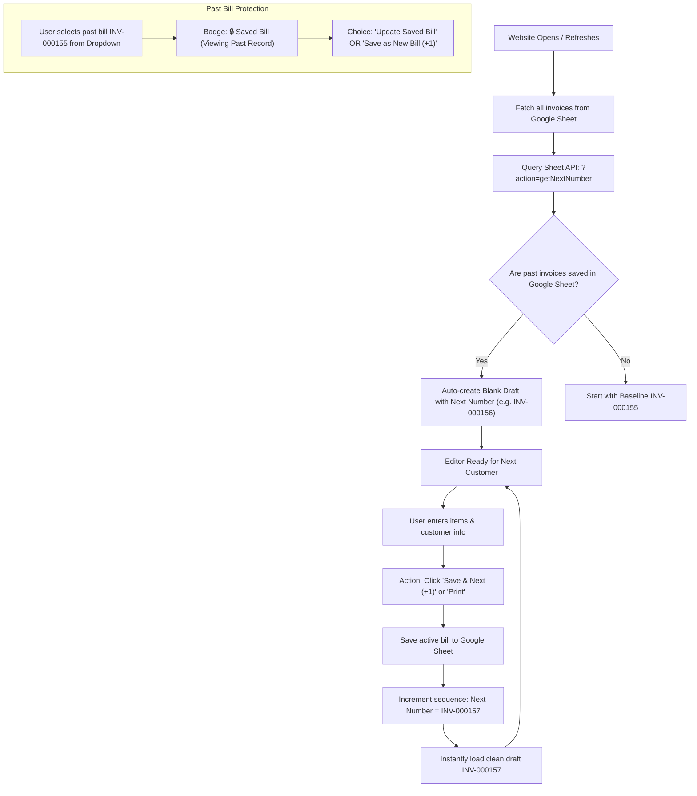

# Plan: Bulletproof Auto-Incrementing Invoice Number Architecture

## 1. Objective & Problem Statement
In a fast-paced billing environment (such as **Vikas Digital Signature Shop**):
- When a bill is completed and printed for a customer (e.g. `INV-000155` for Bharat Singh), the application must **automatically advance to the next sequential invoice number** (`INV-000156`).
- When the website is opened on a new day or new tab, it should **automatically open on a clean, ready-to-bill draft with the next incremented number**, instead of leaving an already-saved past bill on screen where editing could overwrite it.
- When viewing or modifying a past bill, there must be **strict overwrite protection** and an easy **"Save as New Bill (+1)"** option.
- Google Sheet must act as the **central authoritative sequence validator** (`?action=getNextNumber`) so multiple tabs or devices never produce duplicate numbers.

---

## 2. Sequence Workflow Diagram

---

## 3. Detailed Component Plan

### Component 1: Server-Authoritative Number Query (`js/google-sheet.js`)
- Method: `GoogleSheetSync.getNextInvoiceNumber()`
- Target endpoint: `https://script.google.com/macros/s/AKfycby9S2Sxi7lHCQ5GfqKp6z54pGmgzX5i1vifq4dDeOIs2IUAVm-stYzR7L6RntFiLA/exec?action=getNextNumber`
- Response: `{ success: true, nextNumber: "INV-000156" }`
- Client fallback: If offline, `StorageManager.computeNextInvoiceNumber()` scans cached sheet invoices and computes `maxNum + 1`.

### Component 2: Automatic New Bill on Fresh Startup (`js/app.js`)
- Upon opening the website:
  1. Data is fetched from Google Sheet.
  2. If the active invoice in memory is an already-saved historical bill, the app automatically transitions to a fresh draft with the next incremented number (`INV-000156`).
  3. The past bill (`INV-000155`) is preserved in the dropdown selector and history table.
  4. Header status indicator displays: `⚡ New Bill Ready: INV-000156`.

### Component 3: One-Click "Save & Next (+1)" & Auto-Advance on Print (`js/app.js`)
- Toolbar has a prominent green **"Save & Next (+1)"** button and shortcut `Ctrl+Enter`.
- Auto-advance on Print option:
  - When user clicks **Print** (`Ctrl+P`) or **Download PDF**, the bill is saved to Google Sheet, and the editor automatically loads the next bill.

### Component 4: Overwrite Protection for Past Invoices
- When a past invoice is loaded from the dropdown:
  - Mode badge shows: `🔒 Saved Bill: INV-000155`.
  - Two distinct buttons:
    - `Update This Saved Bill` (with confirmation to avoid accidental edits)
    - `⚡ Save as New Bill (Auto +1)` (clones the items and customer to the next sequential invoice number)

### Component 5: Settings Synchronizer
- In the Settings tab:
  - Shows current prefix (e.g. `INV-`).
  - Shows "Next Sequential Number" field with real-time value from Google Sheet.
  - "Re-sync Sequence from Google Sheet" button to verify and align numbers.

---

## 4. Ralph User Stories Roadmap
- **US-012**: Integrate Google Sheet `?action=getNextNumber` in client sync.
- **US-013**: Default app launch to ready-to-bill draft with next sequential number.
- **US-014**: Auto-advance to next bill on Save & Next / Print with keyboard shortcuts.
- **US-015**: Saved invoice safety lock & "Save as New Bill (+1)" clone action.
- **US-016**: Settings sequence synchronizer and prefix manager.
